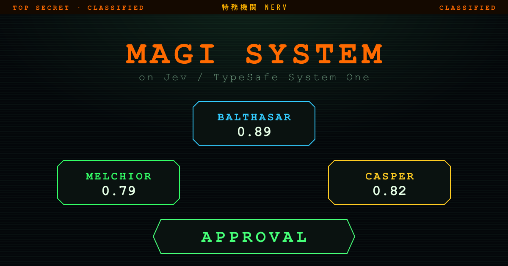

# MAGI SYSTEM on Strands Decider 2B

[English](README.en.md) | [日本語](README.ja.md)

Recreate the **MAGI system** from *Neon Genesis Evangelion* with **Strands Decider 2B**,
the small, open-source "decision model" from the AWS Strands team. Three sages judge
your question independently and decide by a majority vote over calibrated probabilities.

新世紀エヴァンゲリオンの **MAGIシステム** を、AWS Strands チームによる小さな
オープンソース「意思決定モデル」**Strands Decider 2B** で再現。3賢者が議題を
独立に判断し、確率つき多数決で結論を出します。

- 📖 **English** → [README.en.md](README.en.md)
- 📖 **日本語** → [README.ja.md](README.ja.md)

> This is a fork of [magi-system-on-jev](https://github.com/hide-G/magi-system-on-jev)
> with Jev (TypeSafe AI) swapped out for **Strands Decider 2B** (AWS, open source).
> Jev版からモデルを **Strands Decider 2B** に差し替えた版です。

